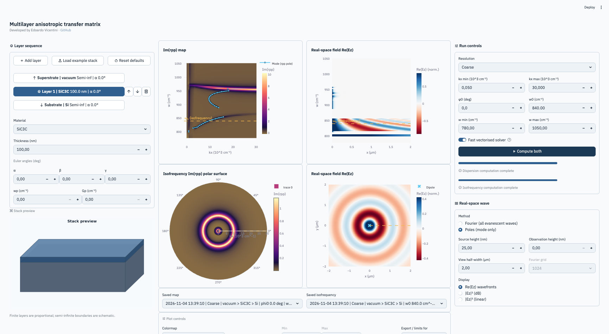

# Multilayer Anisotropic Transfer Matrix

[](https://github.com/vicentini-edoardo/Multilayer_anisotropic_Transfer_Matrix/actions/workflows/tests.yml)
[](https://doi.org/10.5281/zenodo.XXXXXXX)
[](LICENSE)
[](pyproject.toml)

A Python package and [Streamlit](https://streamlit.io) app for the optical reflection of layered, anisotropic media. It implements the generalized 4 × 4 transfer-matrix formalism of Passler & Paarmann (2017) and is aimed at polaritonic materials, for example surface phonon polaritons in polar-dielectric heterostructures.

**Try it online:** [multilayeranisotropictransfermatrix-ev.streamlit.app](https://multilayeranisotropictransfermatrix-ev.streamlit.app)

**Project website:** [vicentini-edoardo.github.io/Multilayer_anisotropic_Transfer_Matrix](https://vicentini-edoardo.github.io/Multilayer_anisotropic_Transfer_Matrix/)



## Features

- Stacks with semi-infinite superstrate and substrate and any number of finite layers, each with its own z–x–z Euler orientation.
- **Dispersion map:** p-polarised `Im(rpp)` versus wavenumber ω and in-plane wavevector kx.
- **Isofrequency map:** `Im(rpp)` versus in-plane azimuth φ and kx at fixed ω.
- **Mode trace:** complex kx of the optical mode (pole of `rpp`) versus ω, overlaid on the dispersion map.
- **Vertical-dipole surface-wave map:** normalized near-field intensity reconstructed from a full 360° isofrequency sweep.
- Built-in material catalog ([Materials Library](https://github.com/vicentini-edoardo/Materials_Library)), custom isotropic and diagonal-anisotropic materials (Lorentz oscillators or tabulated ε), and an optional Drude term per layer.
- Vectorised NumPy solver (about 10–20× faster than the per-point path on dense grids) with process-level parallelism.
- Export of data (CSV) and figures (PNG).

## Quick start

### One-click (no Python or Git needed)

Download the repository (green **Code** → **Download ZIP**), unzip it, then double-click:

| | Install (first run, also repairs) | Open (later runs) |
|---|---|---|
| macOS | `Install_Multilayer_ATM_macOS.command` | `Open_Multilayer_ATM_macOS.command` |
| Windows | `Install_Multilayer_ATM_Windows.bat` | `Open_Multilayer_ATM_Windows.bat` |

Install downloads [uv](https://docs.astral.sh/uv/), creates a local `.venv`, installs the app and starts it in your browser. Re-run Install if you move the folder. On macOS, if the launcher is blocked, right-click → Open the first time.

### Manual

Python 3.11 or newer is required.

```bash
git clone https://github.com/vicentini-edoardo/Multilayer_anisotropic_Transfer_Matrix.git
cd Multilayer_anisotropic_Transfer_Matrix
python -m pip install -e .
python -m streamlit run app.py
```

Use as a library:

```python
from multilayer_atm import LayerSpec, StackSpec, compute_rpp_map

stack = StackSpec.from_layers([
    LayerSpec("vacuum", 0.0),
    LayerSpec("SiC3C", 100e-9),   # 100 nm layer
    LayerSpec("Si", 0.0),         # first and last layers are semi-infinite
])

w_cm1, kx_cm1, im_rpp = compute_rpp_map(
    stack, w_min=700, w_max=1100, nw=160, kx_min=0, kx_max=5000, nk=180, workers=1,
)
```

Frequencies and in-plane wavevectors are in cm⁻¹, thicknesses in metres, angles in degrees.

## Documentation

| Document | Contents |
|---|---|
| [Install guide](docs/install-guide.md) | One-click and manual installation, troubleshooting |
| [User guide](docs/user-guide.md) | Using the Streamlit app, step by step |
| [Python API](docs/python-api.md) | Models, solver entry points, return shapes, examples |
| [Theory and conventions](docs/theory.md) | Formalism, Euler angles, units, mode trace, dipole map |
| [Materials](docs/materials.md) | Built-in catalog, custom materials, JSON and table formats |
| [Development](docs/development.md) | Architecture, tests, contributing |
| [Releasing and Zenodo](docs/releasing.md) | Cutting a release and archiving it on Zenodo |
| [Changelog](CHANGELOG.md) | Version history |

## GitHub Pages

The project website is published from the `docs/` folder on the `main` branch. In **Settings → Pages**, select **Deploy from a branch**, then choose `main` and `/docs`.

## Scope and limitations

- Permittivity tensors are diagonal in the material's principal-axis frame (isotropic, uniaxial, biaxial); orientation is applied by Euler rotation. Off-diagonal permittivity, magnetic anisotropy and non-local effects are not modelled.
- Layers are laterally homogeneous with flat, sharp interfaces.
- The dipole map is a band-limited post-processing estimate, not absolute power; check convergence against momentum and angular sampling and FFT size.
- The stack sketch in the app is schematic.

## Citing

If you use this software, please cite both the paper below and this repository (see [`CITATION.cff`](CITATION.cff); each tagged release is archived on Zenodo, which provides a version-specific DOI).

> Software: E. Vicentini, *Multilayer anisotropic transfer matrix* (v0.1.0), Zenodo, [doi:10.5281/zenodo.XXXXXXX](https://doi.org/10.5281/zenodo.XXXXXXX) <!-- TODO: replace XXXXXXX with the Zenodo DOI -->

> N. C. Passler and A. Paarmann, “Generalized 4 × 4 matrix formalism for light propagation in anisotropic stratified media: study of surface phonon polaritons in polar dielectric heterostructures,” *J. Opt. Soc. Am. B* **34**(10), 2128 (2017). [doi:10.1364/JOSAB.34.002128](https://doi.org/10.1364/JOSAB.34.002128)

## License

MIT, see [`LICENSE`](LICENSE). The built-in material catalog is maintained separately in the [Materials Library](https://github.com/vicentini-edoardo/Materials_Library).
